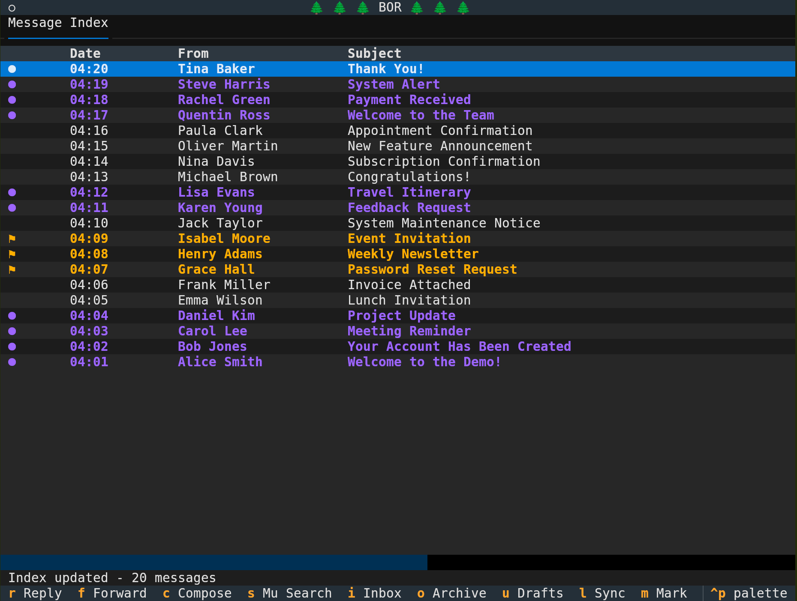
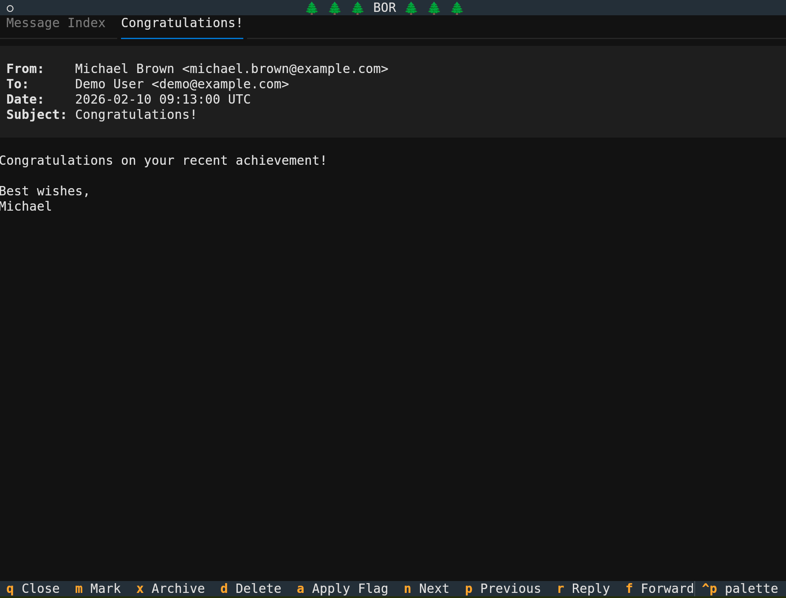
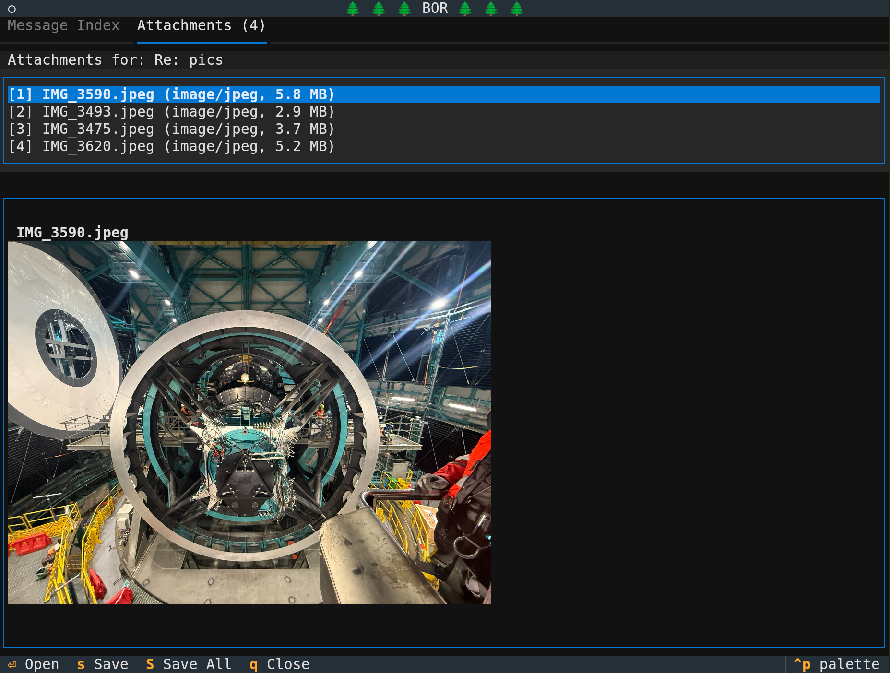

# Bor - Terminal Email Reader

[](https://github.com/slosar/bor/actions/workflows/tests.yml) [](https://pypi.org/project/bormail/)

Bor means pine in Slovenian. Bor is also an email reader inspired by [pine](https://en.wikipedia.org/wiki/Pine_%28email_client%29).

I used to use pine and later its derivatives (alpine, realpine) until it became unsustainable. I switched to mu4e over a decade ago, but while I liked many things, it was never quite perfect.

A few years ago I switched away from emacs to VSCode and with the advent of AI coding I finally bite the bullet and made my very own mail client that works exactly the way I want it. Think of bor as pine dragged (by its feet) into 2025.

Bor uses [mu](https://djcbsoftware.nl/code/mu/) for email access under the hood and [Textual](https://textual.textualize.io/) for the user interface.

## Some screenshots

### Message index

### Tabbed message reading

### In-terminal preview using kitty terminal protocol


## Features

- **Fast email searching** using mu's powerful query language
- **Threaded message view** with visual indentation
- **Message composition** with address autocompletion and Ctrl-C/V/X handling global clipboard even in terminal
- **Attachment handling** with preview (using kitty terminal graphics capabilities) 
- **Keyboard-driven interface** 
- **Tab-based workflow** 
- **Configurable** via TOML configuration file
- **HTML email support** via html2text rendering
- **LLM mail search** (optional): ask questions about your mail in plain language; the model searches and reads it through mu (read-only) via any OpenAI-compatible API such as OpenRouter

## Requirements

- Python 3.10+
- [mu](https://djcbsoftware.nl/code/mu/) (maildir indexer)
- [Textual](https://textual.textualize.io/) library
- Optional: html2text for HTML email rendering
- Optional: kitty terminal for image preview


## Known issues

- no support for folders. You can mu search with maildir:/folder, but all archived messages go to the archived folder. This is how my work-flow works. Feel free to add and make pull request.

## Installation

### From PyPI

```bash
pip install bormail
```

### From source

```bash
# Clone the repository
git clone https://github.com/slosar/bor.git
cd bor

# Install with pip (add [all] for html2text, keyring and Pillow)
pip install -e ".[all]"
```

### Dependencies

```bash
# Install mu on Debian/Ubuntu
sudo apt install maildir-utils

# Install mu on Arch Linux
sudo pacman -S mu

# Install mu on macOS
brew install mu
```

## Release

1. Update the version in `pyproject.toml`.
2. Create a git tag like `v0.1.1` and publish a GitHub Release.
3. The Build workflow will upload the sdist and wheel to PyPI.
    - Configure PyPI Trusted Publishing for `slosar/bor` before the first release.

## Configuration

Copy the example configuration file and customize it:

```bash
cp bor.conf.example ~/.config/bor.conf
```

Edit `~/.config/bor.conf` to configure:
- SMTP server settings
- Maildir folder paths
- Display preferences
- Color scheme
- Synchronization command
- Email and text aliases

See the [configuration documentation](documentation/configuration.md) for details.

## Usage

Start Bor:

```bash
python -m bor.app
```

Or if installed:

```bash
bor
```

## Keyboard Shortcuts

### Global

| Key | Action |
|-----|--------|
| Alt+0 | Message Index tab |
| Alt+1-9 | Switch to tab |
| Ctrl+Q | Quit |

### Message Index

| Key | Action |
|-----|--------|
| ↑/↓ or N/P | Navigate messages |
| Enter | Open message |
| R | Reply |
| F | Forward |
| C | Compose new |
| S | Search (mu query) |
| I | Show Inbox |
| O | Show Archive |
| U | Show Drafts |
| M | Mark message |
| X | Archive message(s) |
| A | Apply flag |
| D | Delete message(s) |
| E | Edit draft |
| T | Toggle threading |
| Ctrl+T | Show thread |
| L | Sync |
| Q | Ask the LLM about your mail |
| K / Shift+K | Show / clear the messages the LLM picked |
| Ctrl+S | LLM: summarize the marked messages |
| Z | Undo move |
| Ctrl+R | Refresh index |

### Message View

| Key | Action |
|-----|--------|
| Space/PgDn | Scroll down |
| < | Return to index (keep tab open) |
| Q | Close tab and return |
| N/P | Next/Previous message |
| R | Reply |
| F | Forward |
| C | Compose new |
| M | Mark/unmark message and advance |
| X | Archive |
| D | Delete |
| A | Apply flag |
| O | Open URL (if multiple, pick [1-9]) |
| V | View message in browser |
| Z | View attachments |
| Ctrl+R | Toggle full headers |

### Compose

| Key | Action |
|-----|--------|
| Tab | Autocomplete address/text |
| Ctrl+L L | Send message |
| Ctrl+L D | Save draft |
| Ctrl+L X | Cancel (asks to confirm) |
| Ctrl+L A | Attach file |
| Ctrl+L Z | Attach many files from a directory |
| Ctrl+I | Insert file (terminals that distinguish Ctrl+I from Tab, e.g. kitty) |

`Ctrl+L A` opens a file-path prompt with bash-like tab completion: one match completes
immediately, multiple matches are listed without forcing a choice, and the input expands only
to the longest shared prefix.

`Ctrl+L Z` first prompts for a directory with the same tab-completion behavior, then opens a file picker where
`Space` marks files, `Enter` attaches the marked set, `Esc` cancels, and `Ctrl+A` toggles all.

### Attachments

| Key | Action |
|-----|--------|
| 1-9 | Select attachment |
| Enter | Open with system viewer |
| S | Save attachment |
| Shift+S | Save all |
| Q or Esc | Close and return to message view |
| < | Return to index (keep tab open) |

**URL opener limitation**

The URL picker shows and opens the first 9 URLs. If a message has more than 9 URLs, it is easier to copy/paste the link or use terminal link clicking instead.

## Search Queries

Bor uses mu's query language. Examples:

```
# Search in inbox
maildir:/INBOX

# Unread messages
flag:unread

# From a specific sender
from:john@example.com

# Subject contains word
subject:meeting

# Date range
date:1w..now

# Combine queries
from:john subject:meeting flag:unread
```

See the [mu query documentation](https://djcbsoftware.nl/code/mu/mu4e/Queries.html) for more.

## Development

### Project Structure

```
bor/
├── __init__.py       # Package init
├── app.py            # Main Textual application
├── config.py         # Configuration handling
├── editing.py        # Shared text-editing / clipboard helpers
├── ical.py           # Calendar invite parsing
├── mu.py             # Mu interface
├── profiling.py      # UI latency profiler (python -m bor.profiling)
├── llm/
│   ├── conversation.py  # Tool-calling loop over an OpenAI-compatible API
│   ├── prompt.py     # System prompt and per-question context
│   ├── session.py    # App-wide LLM state
│   └── tools.py      # Read-only mail tools (search, read, thread)
└── tabs/
    ├── __init__.py
    ├── base.py       # Base tab class
    ├── message_index.py
    ├── message.py
    ├── compose.py
    ├── attachments.py
    ├── llm.py        # LLM chat tab
    └── sync.py
```

### Running tests

```bash
pytest tests/
```

## License

MIT License - see LICENSE file for details.

## Credits

- [mu/mu4e](https://djcbsoftware.nl/code/mu/) - Email indexing and searching
- [Textual](https://textual.textualize.io/) - TUI framework
- Inspired by traditional email clients like pine, mutt, and mu4e
